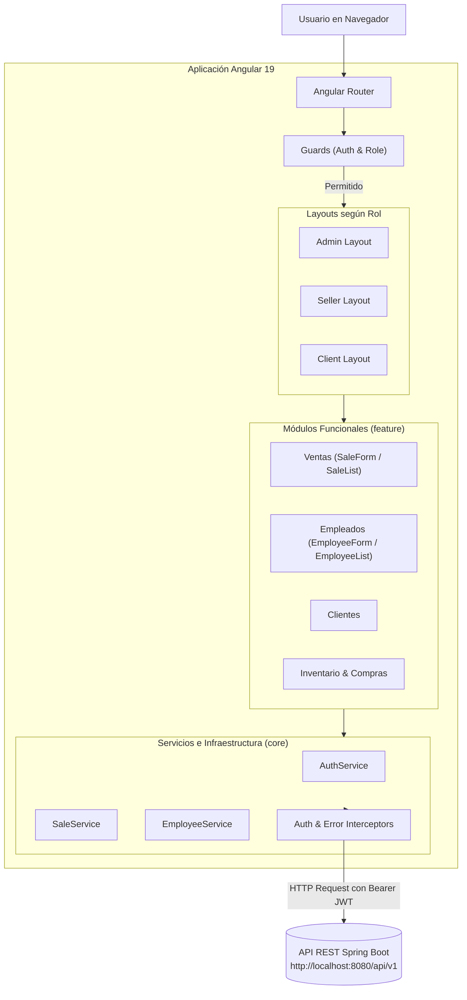

# Importaciones D&G - Frontend Web SPA

Single Page Application (SPA) empresarial desarrollada con **Angular 19** y **TailwindCSS 4** para la administración comercial, gestión de compras internacionales, inventario, control de personal y registro de ventas. Constituye el cliente web del ecosistema multiplataforma de Importaciones D&G, conectando de forma reactiva con la API RESTful en Spring Boot 3 y ofreciendo interfaces dinámicas adaptadas según el rol del usuario (`ADMINISTRADOR`, `VENDEDOR` y `CLIENTE`).


---

## 1. Funcionalidades Principales

- **Control de Acceso Basado en Roles (RBAC)**: Protección de rutas mediante Guards funcionales (`auth.guard` y `role.guard`), redirigiendo a layouts exclusivos para Administradores, Vendedores y Clientes.
- **Módulo de Ventas e Inventario**: Registro dinámico de ventas con validación de stock, selección de clientes, cálculo de importes y desglose de detalles en tiempo real.
- **Mantenimiento Integral de Empleados**: Gestión de personal con formularios reactivos, asignación de roles, validaciones de identidad y actualización parcial de datos.
- **Interceptores HTTP Centralizados**: Inyección automática del token JWT (`Authorization: Bearer <token>`) en cada petición saliente y captura global de errores HTTP (401, 403, 500).
- **Diseño Moderno y Responsivo**: Interfaz construida con **TailwindCSS v4**, con soporte para temas, barra lateral colapsable y componentes modulares accesibles.

---

## 2. Stack Tecnológico

| Tecnología | Rol en el Proyecto |
| :--- | :--- |
| **Angular 19.2** | Framework frontend basado en TypeScript con componentes Standalone y enrutamiento modular. |
| **TypeScript 5.7** | Lenguaje tipado para modelado de contratos de datos (`interfaces`) y lógica de componentes. |
| **TailwindCSS 4.1** | Framework de utilidades CSS para diseño responsivo y maquetación de layouts. |
| **RxJS 7.8** | Programación reactiva y manejo asíncrono de flujos de datos (`Observable`, `map`, `catchError`). |
| **Angular Router** | Navegación SPA con carga perezosa (*lazy loading*) y protección de rutas. |
| **Reactive Forms** | Manejo de formularios complejos con validaciones asíncronas y tipado estricto. |
| **FontAwesome Free 6.7** | Librería de iconografía para interfaces de usuario y paneles administrativos. |
| **Jasmine & Karma** | Entorno de pruebas unitarias para componentes, guards y servicios. |

---

## 3. Arquitectura Frontend

La aplicación sigue el patrón **Core / Feature / Shared / Layout**:

- **Core (`src/app/core/`)**: Módulo singleton que contiene servicios de infraestructura, interceptores HTTP, guards de navegación y modelos TypeScript.
- **Feature (`src/app/feature/`)**: Módulos funcionales de negocio (autenticación, empleados, ventas, compras, clientes, inventario).
- **Layout (`src/app/layout/`)**: Estructuras maestras de navegación (`AdminLayout`, `SellerLayout`, `ClientLayout`) que envuelven las vistas según los permisos del usuario.
- **Shared (`src/app/shared/`)**: Componentes reutilizables (navbar, sidebar) y servicios de utilidad (notificaciones).



---

## 4. Estructura del Proyecto

```text
importaciones-frontend/
├── src/
│   ├── app/
│   │   ├── core/                      # Servicios transversales, interceptores y contratos
│   │   │   ├── guards/                # auth.guard.ts, role.guard.ts
│   │   │   ├── interceptors/          # auth.interceptor.ts, error.interceptor.ts
│   │   │   ├── interfaces/            # Modelos TypeScript (sale, employee, product, user)
│   │   │   ├── service/               # Servicios HTTP (auth, sale, employee, etc.)
│   │   │   └── validators/            # Validadores para formularios reactivos
│   │   ├── feature/                   # Vistas y componentes de negocio
│   │   │   ├── auth/                  # Login, registro y cambio de contraseña
│   │   │   ├── employees/             # Gestión de personal (list, form, detail)
│   │   │   ├── sales/                 # Registro y consulta de ventas (list, form, detail)
│   │   │   ├── clients/               # Cartera de clientes
│   │   │   ├── products/              # Catálogo de productos y stock
│   │   │   └── purchases/             # Registro de órdenes de compra/importación
│   │   ├── layout/                    # Layouts maestros (admin, seller, client)
│   │   ├── shared/                    # Componentes compartidos (navbar, sidebar, alertas)
│   │   ├── app.config.ts              # Configuración de proveedores (HTTP, Router)
│   │   └── app.routes.ts              # Árbol central de rutas y guardias
│   ├── environments/                  # Variables de entorno (development, production)
│   │   ├── environment.development.ts
│   │   ├── environment.prod.ts
│   │   └── environment.ts
│   ├── index.html                     # Plantilla HTML base
│   ├── main.ts                        # Punto de arranque de la aplicación
│   └── styles.css                     # Configuración global y directivas de TailwindCSS
├── angular.json                       # Configuración de compilación de Angular CLI
├── package.json                       # Dependencias y scripts del proyecto
├── tsconfig.json                      # Configuración del compilador TypeScript
└── README.md                          # Documentación técnica del repositorio
```

---

## 5. Seguridad y Gestión de Sesión

1. **Inyección Automática de Tokens (`auth.interceptor.ts`)**:
   - Cada solicitud HTTP saliente hacia la API backend es interceptada para adjuntar el encabezado `Authorization: Bearer <token>` si existe una sesión activa.
2. **Manejo de Errores Globales (`error.interceptor.ts`)**:
   - Captura respuestas `401 Unauthorized` o `403 Forbidden` para cerrar la sesión local y redirigir al usuario al login.
3. **Guardias de Navegación**:
   - `auth.guard.ts`: Valida que el usuario tenga un token vigente antes de cargar rutas protegidas.
   - `role.guard.ts`: Restringe rutas específicas según los roles asignados en el JWT (`ADMINISTRADOR`, `VENDEDOR`, `CLIENTE`).

---

## 6. Integración con la API Backend

La aplicación se comunica con el backend de **Spring Boot 3** a través de `HttpClient`:

| Servicio Frontend | Endpoint Backend Consumido | Descripción |
| :--- | :--- | :--- |
| `AuthService` | `POST /api/v1/auth/login` | Autenticación y recepción de access/refresh token. |
| `SaleService` | `POST /api/v1/sale/create` | Envío de orden de venta con detalle de ítems. |
| `SaleService` | `GET /api/v1/sale/list` | Listado histórico de ventas. |
| `EmployeeService` | `GET /api/v1/employee/listEmployee` | Consulta de personal activo para asignación. |
| `EmployeeService` | `POST /api/v1/employee/saveEmployee` | Registro de nuevo empleado. |
| `EmployeeService` | `PATCH /api/v1/employee/partialUpdate/{id}` | Actualización puntual de datos. |

---

## 7. Cómo Ejecutar Localmente

### Requisitos Previos
- **Node.js**: v18.19.0 o v20.x recomendado.
- **npm**: v9.x o superior.
- **Angular CLI**: Instalado globalmente (`npm install -g @angular/cli`).
- Backend **Importaciones D&G API** ejecutándose en `http://localhost:8080`.

### Pasos de Instalación

1. **Clonar el repositorio:**
   ```bash
   git clone https://github.com/LorenzoCampos03/importaciones-dg-frontend.git
   cd importaciones-dg-frontend
   ```

2. **Instalar dependencias:**
   ```bash
   npm install
   ```

3. **Verificar configuración del entorno:**
   Revisar que [environment.development.ts](src/environments/environment.development.ts) apunte a la URL correcta del backend:
   ```typescript
   export const environment = {
     production: false,
     apiUrl: 'http://localhost:8080/api/v1',
     apiVersion: 'v1'
   };
   ```

4. **Iniciar el servidor de desarrollo:**
   ```bash
   npm start
   # o bien:
   ng serve
   ```

5. **Acceder a la aplicación:**
   Abrir en el navegador: [http://localhost:4200](http://localhost:4200)

---

## 8. Pruebas Automatizadas

La aplicación cuenta con configuración de pruebas unitarias con **Jasmine** y el ejecutor **Karma**:

```bash
# Ejecutar suite de pruebas unitarias
npm test

# Ejecutar pruebas en modo CI (sin interfaz gráfica)
ng test --watch=false --browsers=ChromeHeadless
```

---

## 9. CI/CD

- **Estado actual**: Sin pipeline de integración continua configurado actualmente en el repositorio (roadmap: GitHub Actions para linting, test y build automático).

---

## 10. Rol y Aportes en el Proyecto

- **Modalidad**: Proyecto colaborativo en equipo (2 desarrolladores frontend/backend).
- **Módulos de responsabilidad directa (Lorenzo Campos)**:
  - **Módulo de Ventas**: Desarrollo de las interfaces de registro (`SaleFormComponent`), listado histórico (`SaleListComponent`) y detalle (`SaleDetailComponent`), implementando formularios reactivos y cálculo automático de subtotales e importes totales.
  - **Módulo de Empleados**: Construcción de las pantallas de gestión de personal (`EmployeeListComponent`, `EmployeeFormComponent`), validaciones de documentos y formulario reactivo con soporte de actualización parcial (`PATCH`).
  - **Capa de Servicios e Integración**: Tipado estricto mediante interfaces TypeScript (`sale.interface.ts`, `employee.interface.ts`) y consumo de endpoints REST con RxJS.
- **Desarrollo en conjunto**:
  - Estructuración de la arquitectura en capas (Core / Feature / Shared / Layout) y configuración de rutas con Angular Router.
  - Implementación de `auth.guard.ts` e inyección de tokens en `auth.interceptor.ts`.
  - Maquetación y estilización con TailwindCSS v4 de los layouts de Administrador y Vendedor.

---

## 11. Roadmap / Posibles Mejoras

1. **Migración a Signals**: Adoptar Angular Signals para un manejo de estado reactivo más eficiente y sin necesidad de suscripciones manuales.
2. **Contenedorización para Producción**: Crear un `Dockerfile` multietapa con **Nginx** para servir la aplicación compilada en entornos productivos.
3. **Pruebas End-to-End (E2E)**: Integrar **Playwright** o **Cypress** para pruebas de flujos críticos (login, emisión de venta completa).

---

## 12. Contacto

- **Desarrollador**: Lorenzo Campos
- **LinkedIn**: [linkedin.com/in/lorenzo-campos](https://www.linkedin.com/in/lorenzo-campos)
- **Correo Electrónico**: [lorenzo.campos.p@vallegrande.edu.pe](mailto:lorenzo.campos.p@vallegrande.edu.pe)
